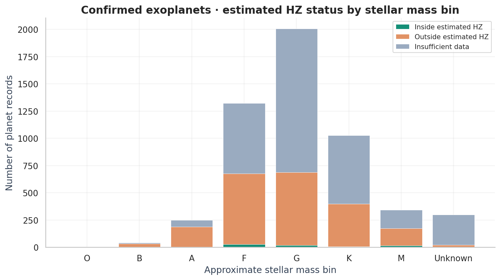
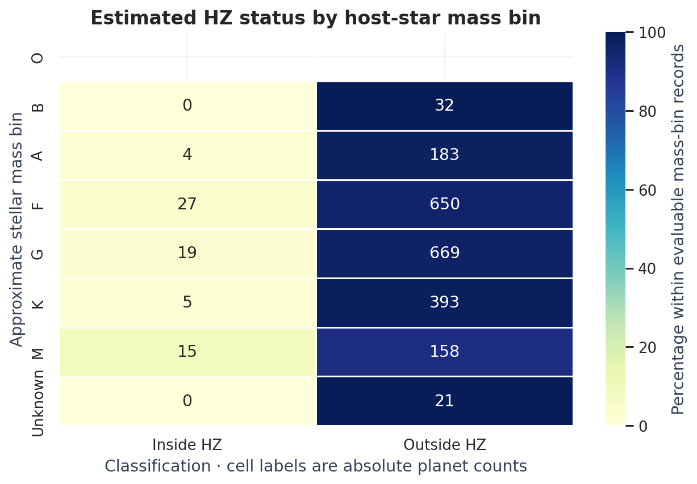
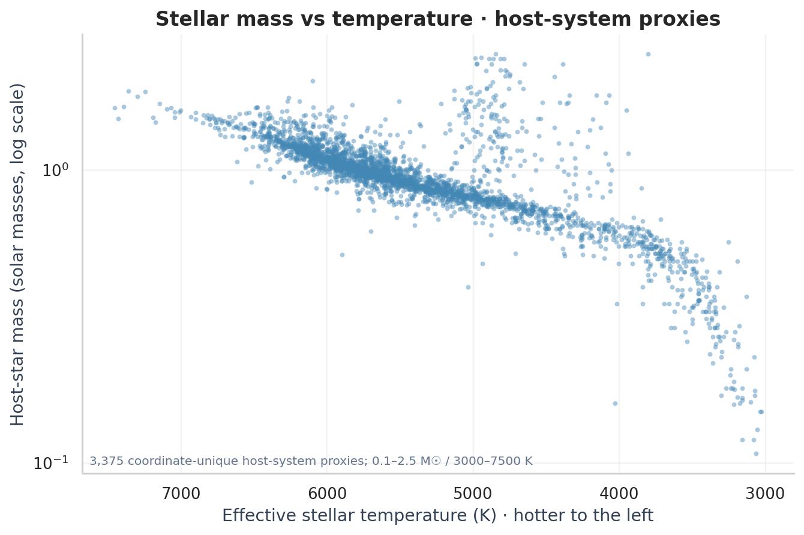
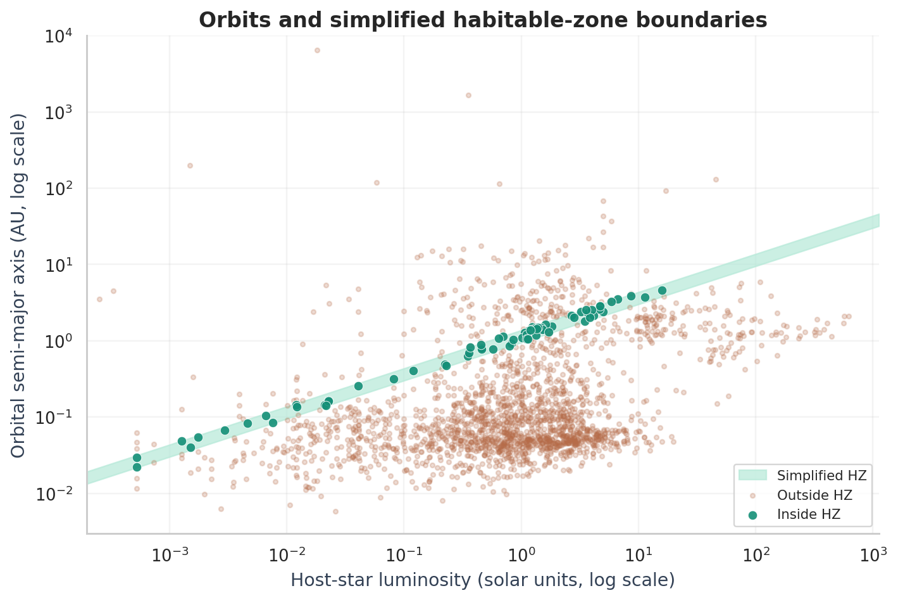

# Exoplanet Habitable-Zone Analysis

**Python · Pandas · NumPy · Matplotlib · Seaborn · Plotly · Astronomy**

A reproducible exploratory data-analysis and visualisation project that estimates
which confirmed exoplanets in a historical [Open Exoplanet Catalogue](https://github.com/OpenExoplanetCatalogue/oec_tables)
snapshot fall within a **simplified, luminosity-scaled habitable-zone interval**.

> **Scientific disclaimer:** Being inside an estimated habitable zone is **not**
> proof that a planet is habitable. The project is an educational screening
> exercise, not a planet-habitability prediction model.

## At a glance

| Metric | Result |
|---|---:|
| Original source records | **5,414** |
| Confirmed exoplanet records (analysis subset) | **5,288** |
| Sufficient stellar/orbital data | **2,176** |
| Inside the simplified HZ | **70** |
| Outside the simplified HZ | **2,106** |
| Insufficient input data | **3,112** |

Within the **evaluable** confirmed subset, **70 / 2,176 = 3.22%** meet the
specified distance criterion. This is **not** an estimated fraction of all
exoplanets in habitable zones: it is affected by missing data and observational
selection biases.

## Visualisations

### 1. Sample coverage and estimated HZ membership



The key improvement from the original notebook is explicitly separating
`Insufficient data` from `Outside estimated HZ`.

### 2. Heatmap — conditional on evaluable planets



Colour shows the **percentage within evaluable records in each mass bin**;
cell text shows the **absolute count**. The O-type row is empty because that
mass bin has no evaluable records in this snapshot.

### 3. Stellar mass vs temperature



Each mark represents one unique sky-coordinate **host-system proxy** rather
than every planet. The temperature axis is reversed by astronomical
convention; stellar-mass bins are **not spectroscopic classifications**.

### 4. Orbital distance and model HZ boundaries



The green area shows the geometrically estimated zone between the two
fixed-flux limits. A point in this area does not establish that its planet
can support life.

### 5. Additional plots and interactive visualisations

- [Mass-bin distribution](figures/01_stellar_mass_bins.png)
- [Incident stellar flux distribution](figures/05_incident_flux_distribution.png)
- [Discovery method comparison](figures/07_discovery_methods.png)
- [Static treemap preview](figures/08_treemap_static_preview.png)
- [**Interactive Plotly treemap**](figures/interactive_treemap.html) — download
  and open the HTML file in your browser for hover and zoom.
- [**Interactive stellar scatterplot**](figures/interactive_stellar_scatter.html)
  — similarly opens in a browser.

## Method

The original coursework idea is preserved: estimate stellar luminosity from
observed stellar radius and effective temperature using a dimensionless
Stefan–Boltzmann scaling:

\[
\frac{L_\star}{L_\odot} =
\left(\frac{R_\star}{R_\odot}\right)^2
\left(\frac{T_\star}{5778\,\mathrm{K}}\right)^4
\]

Use the original **educational fixed-flux thresholds** (Earth = 1):

\[
 a_{\mathrm{inner}} = \sqrt{\frac{L_\star/L_\odot}{1.10}},
 \qquad
 a_{\mathrm{outer}} = \sqrt{\frac{L_\star/L_\odot}{0.53}}
\]

A planet's `semimajoraxis` (AU) is compared to those limits. If stellar
radius, temperature or semi-major axis is missing/invalid, its status is
**Insufficient data**, not automatically outside the zone.

**Important:** These constant cutoffs follow the coursework's simple model;
modern research models HZ boundaries as a function of stellar temperature,
planet mass and atmosphere. See [methodology and limitations](docs/METHODOLOGY.md).

## Reproduce the analysis

Python 3.10+ recommended.

```bash
python -m venv .venv
# Windows: .venv\\Scripts\\activate
# macOS/Linux: source .venv/bin/activate
pip install -r requirements.txt
python src/exoplanet_analysis.py
python -m pytest -q
```

The script reads the included frozen snapshot from
`data/raw/open_exoplanet_catalogue.csv` and recreates the results in
`figures/` and `data/processed/`. Internet access is **not** required for
reproduction.

Open [`notebooks/Exoplanet_Habitable_Zone_Analysis.ipynb`](notebooks/Exoplanet_Habitable_Zone_Analysis.ipynb)
in Jupyter or VS Code for the narrated walk-through. All of its code cells
have been executed and the figure outputs are embedded for GitHub preview.
The heatmap and interactive treemap are also demonstrated directly as code
in the notebook. See the [validation report](docs/VALIDATION.md) for details.

## Repository contents

```text
exoplanet-habitable-zone-analysis/
├── README.md
├── requirements.txt
├── data/
│   ├── DATA_LICENSE.md
│   ├── raw/open_exoplanet_catalogue.csv
│   └── processed/
│       ├── confirmed_inside_estimated_hz.csv
│       └── hz_status_by_stellar_mass_bin.csv
├── docs/
│   ├── CHANGES_FROM_ORIGINAL.md
│   ├── METHODOLOGY.md
│   └── VALIDATION.md
├── figures/              # PNGs + offline interactive HTML
├── notebooks/
│   └── Exoplanet_Habitable_Zone_Analysis.ipynb
├── src/
│   └── exoplanet_analysis.py
└── tests/
    └── test_analysis.py
```

## Data provenance and credits

- Data: [Open Exoplanet Catalogue — ASCII tables](https://github.com/OpenExoplanetCatalogue/oec_tables).
- Dataset notice and permission: [`data/DATA_LICENSE.md`](data/DATA_LICENSE.md).
- This bundled catalogue is a **historical supplied snapshot** with discovery
  years through 2023, **not** a current 2026 catalogue.
- The flat ASCII export can lose multi-star architecture, so the single-star
  method is not appropriate for every binary/circumbinary system.
- Astrophysical discussion: [Kopparapu et al. (2014)](https://doi.org/10.1088/2041-8205/787/2/L29).

## Project history

Adapted and improved from the author's **Advanced Data Visualisation** MSc
coursework. The original research question and core figure types are
maintained. See [the change log](docs/CHANGES_FROM_ORIGINAL.md) for an
itemised, transparent explanation of the corrections.

The project is published to demonstrate **data wrangling, missingness handling,
scientific reasoning, data visualisation, and reproducible Python analysis**.
